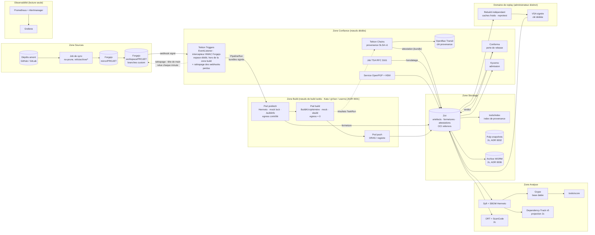
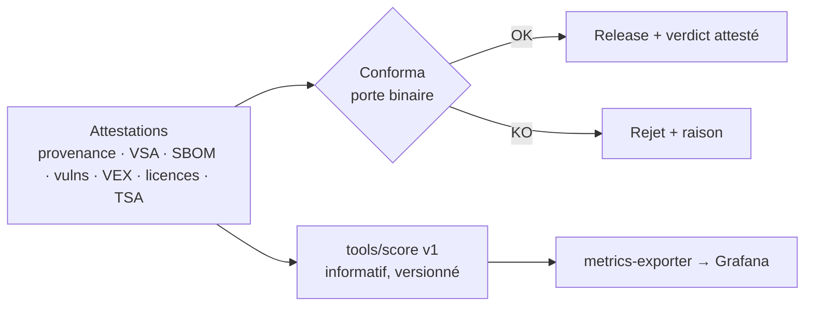

# Architecture cible

> Architecture de l'**hypothèse par défaut** : un « Konflux allégé », c'est-à-dire Tekton + Chains et des briques complémentaires. Si Konflux est retenu par l'ADR 0000, le cœur (zone Build et une partie de la zone Confiance) est remplacé par Konflux, et les autres zones restent identiques.
> Les choix encore ouverts sont signalés par **[ADR xxxx]**.

## 1. Zones et composants



**Principes :**
- **Séparation des zones.** La clé de provenance (OpenBao) et Chains ne tournent jamais sur les nœuds de build. Le domaine de replay a son propre administrateur et sa propre clé.
- **Aucun secret dans la zone build.** Quiconque crée un TaskRun peut monter un secret de son espace, sans droit RBAC sur les secrets. Le secret HMAC du webhook et l'EventListener vivent donc dans un espace de la zone Confiance, et les identifiants de registre de Chains dans l'espace de Chains. Le compte des TaskRuns n'a aucun droit ni jeton monté. L'EventListener ne peut que créer des PipelineRuns dans l'espace des builds (brique 08, J6).
- **Tout est adressé par digest.** Commit git, images de build, tâches Tekton (bundles), fermetures de dépendances, snapshots, artefacts.
- **Les attestations sont la source de vérité.** Index, score, Dependency-Track et métriques en sont des **projections reconstructibles**.
- **Les métriques informent, elles ne décident jamais.** Les portes sont Conforma (release) et Kyverno (admission).

## 2. Flux d'un build

```mermaid
sequenceDiagram
  autonumber
  participant F as Forgejo (workspace)
  participant T as Tekton Triggers (HMAC)
  participant P as Pod prefetch
  participant B as Pod build (egress=0)
  participant Z as Zot
  participant C as Chains (+OpenBao)
  participant S as Job TSA
  participant A as Analyse (Syft/Grype/licences)
  participant R as Domaine de replay
  participant E as Conforma

  F->>T: push sur branche custom (webhook signé)
  T->>T: vérifie HMAC + anti-rejeu, crée le PipelineRun (bundles signés)
  T->>F: rattrapage chaque minute (Forgejo ne relivre jamais un webhook en échec) : tête de main lue, PipelineRun créé s'il manque, même gabarit [brique 08, J6]
  T->>P: prefetch (Hermeto / mock lock / .buildinfo)
  P->>Z: fermeture des dépendances (OCI, fichier par fichier) + SBOM Hermeto
  T->>B: build hermétique (SOURCE_DATE_EPOCH, images par digest)
  B->>Z: artefacts (binaire, image, rpm, deb via ORAS)
  B-->>C: résultats *_ARTIFACT_* / IMAGE_DIGEST
  C->>C: provenance SLSA v1 (slsa/v2alpha4), signée via OpenBao
  C->>Z: signature + attestation (mode dsse en attendant chains#2096, puis bundle en referrer ; en dsse, écritures du tag .att non atomiques : brique 08)
  S->>Z: horodatage RFC 3161 par réconciliation périodique (CronJob, chaque minute, lecture de Zot seule) : par enveloppe de Chains vérifiée (clé de Chains, sujet = digest de l'image) avant toute demande au TSA, jeton du TSA (clé Transit tsa) sur la signature, bundle v0.3 réémis dans un dépôt séparé de celui de l'image [brique 08, J5 ; automatique en J6]
  Z->>A: SBOM, scan Grype (base datée), licences
  A->>Z: SBOM, résultats, VEX appliqués (attestations)
  Z->>R: provenance + entrées épinglées
  R->>R: rebuild offline, caches froids, ≥ 24 h, comparaison sha256
  R->>Z: VSA signée (clé du domaine de replay) + diffoscope si écart
  Z->>E: provenance + VSA + SBOM + vulns + licences
  E->>Z: verdict de la porte (attestation) → release ou rejet
```

## 3. Modèle de provenance (SLSA v1.0, produite par Chains)

Esquisse des champs attendus. Chains remplit la structure ; les tâches de confiance fournissent les résultats typés.

```json
{
  "_type": "https://in-toto.io/Statement/v1",
  "subject": [{ "name": "zot.example/artifacts/app/rpm", "digest": { "sha256": "…" } }],
  "predicateType": "https://slsa.dev/provenance/v1",
  "predicate": {
    "buildDefinition": {
      "buildType": "https://tekton.dev/chains/v2/slsa",
      "externalParameters": {
        "git": { "url": "forgejo.example/workspace/app", "ref": "refs/heads/custom/el9", "commit": "…" },
        "target": "rocky-9", "SOURCE_DATE_EPOCH": "…"
      },
      "internalParameters": { "hermetic": true, "isolation": "kata|gvisor|userns", "cpuModel": "x86-64-v3" },
      "resolvedDependencies": [
        { "uri": "git+forgejo.example/workspace/app@refs/heads/custom/el9", "digest": { "sha1": "…" } },
        { "uri": "oci://zot.example/builders/mock-rocky9", "digest": { "sha256": "…" } },
        { "uri": "oci://zot.example/deps/app/hermeto", "digest": { "sha256": "…" } },
        { "uri": "oci://zot.example/deps/app/mock-buildroot-lock", "digest": { "sha256": "…" } },
        { "uri": "oci://zot.example/tekton/tasks/build-rpm", "digest": { "sha256": "…" } }
      ]
    },
    "runDetails": {
      "builder": { "id": "https://supply-chain.example/builders/tekton-chains@v1" },
      "metadata": { "invocationId": "…", "startedOn": "…", "finishedOn": "…" },
      "byproducts": [{ "name": "sbom-hermeto", "digest": { "sha256": "…" } }]
    }
  }
}
```

Points à valider en brique 08 :
- `internalParameters.hermetic` et `isolation` doivent être inscrits **par la plateforme** (configuration Chains et paramètres de la tâche de confiance), pas par le code de build ;
- un sujet non-image (rpm) passe par la référence ORAS avec `isBuildArtifact: true` (déduit du code de Chains, à tester).

## 4. Organisation du stockage (Zot)

| Dépôt OCI | Contenu | Referrers attachés |
|---|---|---|
| `sources/<projet>` | `git bundle` horodatés (copie WORM en 2c) | horodatage |
| `deps/<projet>/<type>` | Fermetures : Hermeto, verrou mock, paquets du `.buildinfo` (couches par fichier) | SBOM Hermeto |
| `builders/<image>` | Images de build construites par la plateforme | provenance, SBOM, signature |
| `tekton/{tasks,pipelines}/<nom>` | Bundles Tekton signés (Trusted Resources) ; la pipeline désigne ses tâches par bundle et digest | aucun : la signature est une annotation de l'objet dans le bundle (`tekton.dev/signature`, brique 08, J6) |
| `artifacts/<projet>/{bin,image,rpm,deb}` | Artefacts livrés | provenance, SBOM, VEX, résultats de scan, licences (NOTICE, SBOM « concluded »), **VSA de replay**, horodatage, verdict de la porte, **bundle de sources GPL**, attestation de lien OpenPGP |

**`tools/index`** se reconstruit à partir de Zot (listes et événements CloudEvents). Il répond en moins d'une minute à deux questions :
- « artefacts construits avec le digest X » (builder, dépendance, tâche) ;
- « attestations d'un sha256 brut » (rpm/deb).

## 5. Porte de politique et score



**La porte rejette** si l'une de ces conditions est vraie :
- provenance ou signature invalide ;
- tâche non approuvée (`trusted_task`) ;
- VSA de replay absente ou KO (hors EL8) ;
- MAL- ;
- KEV sans VEX ;
- violation de licence ERROR ;
- horodatage invalide.

**Score informatif v1** :
- 35 % vulnérabilités après VEX (CVSS × EPSS) ;
- 25 % intégrité (L3 vérifié, reproduit, signé) ;
- 25 % santé amont (Scorecard ; posture CI en O8) ;
- 15 % licences, fraîcheur et qualité SBOM.

EL8 n'est pas mis automatiquement à 0.

## 6. Clés et confiance [ADR 0003]

| Clé | Stockage | Usage | Rotation |
|---|---|---|---|
| Provenance | OpenBao Transit (zone Confiance) | Signatures Chains | Périodique ; horodatage pour la vérifiabilité dans le temps |
| Horodatage (TSA) | OpenBao Transit, clé `tsa` distincte de la clé de provenance (zone Confiance), certifiée par une **racine TSA dédiée**, hors de la CA TLS (brique 08, J5) | Jetons RFC 3161 du job d'horodatage | Certificat feuille annuel ; racine longue, hors ligne en production |
| Tâches et pipelines (Trusted Resources) | PoC : fichier 0600 sur l'hôte d'administration (brique 08, J6) ; en production, KMS ou HSM hors de la zone build | Annotation `tekton.dev/signature` des tâches et pipelines publiés en bundles dans `tekton/` (tkn), vérifiée par le contrôleur de Pipelines (VerificationPolicy, clé publique en clair) | Distincte des clés de provenance et du TSA ; rotation par republication des bundles |
| VSA | KMS du **domaine de replay** | Résultats de replay | Indépendante de la clé de provenance |
| OpenPGP dépôts et paquets | HSM du service de signature isolé | `rpmsign`, `debsign`, `Release`/`repomd` | Expiration planifiée, révocation |
| Racine TUF | **Hors ligne** (cérémonie) | Distribution des clés publiques | Seuils, cérémonie documentée |

## 7. Observabilité

- **Exploitation (2b-1)** : kube-prometheus-stack. Métriques de Tekton, Kyverno, Zot, OpenBao et Forgejo. **5 alertes critiques** :
  - OpenBao scellé ;
  - échec de signature Chains ;
  - replay non bit-identique ;
  - miroir en retard de plus de 24 h ;
  - refus Kyverno anormaux.
- **KPI supply-chain (2c)** : `tools/metrics-exporter` dérive les métriques **des attestations** (taux L3 vérifié, taux de replay identique, KEV ouvertes et délai de correction, couverture VEX, violations de licences, âge des pins et des clés). Seuil : 0 écart avec le recalcul.
- Grafana et Prometheus tournent en **lecture seule**, hors des nœuds de confiance. Les tableaux de bord sont versionnés dans git.

## 8. Choix ouverts

| ADR | Question | Quand |
|---|---|---|
| 0000 | Adopter Konflux ou OBS, ou assembler ? Challengers Nix (build) et Kyverno seul (politique) | Fin de 2a |
| 0001 | Runtime et isolation (k3s, Kata, gVisor, userns) ; infra du PoC ; administrateur du replay | Provisoire en phase 1, définitif en phase 3 |
| 0002 | Snapshots de distros : Pulp ou aptly ; fermetures | Fin de 2c |
| 0003 | Clés, OpenPGP, TSA, TUF | Phase 3 |
| 0004 | Vulnérabilités et VEX (OpenVEX ou CSAF) | Phase 3 |
| 0005 | Licences (politique, curations) | Phase 3 |
| 0006 | Archive WORM (Ceph hors cluster ou S3 Object Lock compliance) | Fin de 2c |
